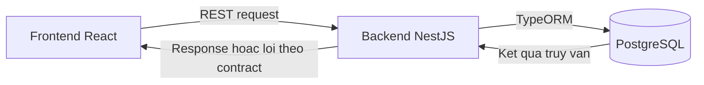

# Layers

Tra trách nhiệm từng lớp và hướng gọi được phép trước khi phát triển frontend hoặc backend.

## 1. Hiện trạng

Áp dụng cách phân lớp đã được Product Owner xác nhận khi bổ sung code.

- `frontend/` có prototype React dùng dữ liệu giả lập; `backend/` hiện rỗng. Tài liệu quy định cách phân lớp mục tiêu.
- Tra kết nối giữa các thành phần tại [Overview](overview.md); tra công nghệ tại [Tech Stack](tech-stack.md).

## 2. Tài liệu theo app

Đọc file tương ứng trước khi thay đổi trách nhiệm hoặc hướng gọi trong app.

| App/framework | Tài liệu | Khi nào cần đọc |
|---|---|---|
| Frontend React | [frontend-react.md](layers/frontend-react.md) | Khi thêm UI, hook, API client hoặc code dùng chung giữa các feature. |
| Backend NestJS | [backend-nestjs.md](layers/backend-nestjs.md) | Khi thêm Controller, Service, truy vấn dữ liệu, kiểm tra request hoặc xử lý lỗi. |

## 3. Nguyên tắc chung

Giữ trách nhiệm trong từng app và giao tiếp giữa các app nhất quán.

- Frontend gọi backend qua REST API; không truy cập PostgreSQL hoặc Repository của backend.
- Backend kiểm tra input, quyền và nghiệp vụ; không dựa riêng vào kiểm tra hoặc việc ẩn nút phía frontend.
- Tuân thủ [REST API Rules](../rules/rest-api.md); không suy ra endpoint, schema, error format hoặc cơ chế xác thực từ sơ đồ phân lớp.
- Giữ chi tiết từng app trong file riêng; dùng liên kết thay vì sao chép nội dung giữa các file.
- Giữ mỗi file tối đa 200 dòng; nếu vượt, đề xuất tách theo chủ đề và chờ Product Owner xác nhận.

## 4. Giao tiếp giữa các app

Theo dõi luồng request và response giữa frontend và backend.

1. Frontend gửi request qua API client chung; có thể gọi qua hook khi cần.
2. Backend kiểm tra request và xử lý nghiệp vụ theo phân lớp NestJS.
3. Backend dùng TypeORM khi cần truy cập PostgreSQL.
4. Backend trả response hoặc lỗi theo contract đã xác nhận.
5. Frontend cập nhật trạng thái và hiển thị kết quả cho người dùng.

- Tra luồng nội bộ chi tiết tại [Frontend React](layers/frontend-react.md) và [Backend NestJS](layers/backend-nestjs.md).
- Không tự đặt API contract; các quyết định chưa rõ tiếp tục giữ TODO trong tài liệu liên quan.

## 5. Tài liệu liên quan

Tra chi tiết theo phạm vi cần thay đổi.

- [Overview](overview.md): Tra thành phần chính và kết nối tổng thể.
- [Tech Stack](tech-stack.md): Tra công nghệ và trạng thái toolchain.
- [Folder Structure](folder-structure.md): Tra vị trí đặt file.
- [Đặc tả yêu cầu](../prd/index.md): Tra yêu cầu và quy tắc nghiệp vụ.
