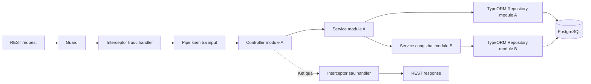

# Backend Layers — NestJS

Tra trách nhiệm và hướng gọi phía backend NestJS trước khi thêm module hoặc xử lý request.

## 1. Hiện trạng

Áp dụng các quy tắc đã được Product Owner xác nhận khi bổ sung code backend.

- `backend/` hiện rỗng; tài liệu quy định cách phân lớp, chưa mô tả code đang chạy.
- Dùng NestJS và TypeORM theo [Tech Stack](../tech-stack.md); backend dùng ESM.
- Dùng Express qua `@nestjs/platform-express` làm HTTP adapter; tra phiên bản và mục chưa xác nhận tại [Tech Stack](../tech-stack.md).

## 2. Trách nhiệm

Tách kiểm tra request, xử lý HTTP, nghiệp vụ và truy cập dữ liệu.

| Thành phần | Trách nhiệm | Hướng gọi hoặc kết quả |
|---|---|---|
| DTO | Mô tả input theo contract đã xác nhận; không chứa nghiệp vụ hoặc truy vấn DB. | Là căn cứ kiểm tra input; không tự thực hiện validation runtime. |
| Pipe | Kiểm tra dữ liệu đầu vào trước Controller. | Input hợp lệ đi tiếp; input sai tạo lỗi theo contract. |
| Guard | Kiểm tra xác thực và quyền gọi operation. | Cho phép hoặc từ chối request theo chính sách đã xác nhận. |
| Interceptor | Xử lý tác vụ chung trước/sau handler khi được áp dụng; không chứa nghiệp vụ hoặc thay thế Guard/Pipe. | Hiện chưa áp dụng custom Interceptor nào. |
| Controller | Nhận request, gọi Service và trả response; không chứa nghiệp vụ hoặc truy vấn DB. | Chỉ gọi Service cùng module. |
| Service | Kiểm tra nghiệp vụ, quyền trên dữ liệu cụ thể và điều phối thao tác dữ liệu. | Gọi Repository của module hoặc Service công khai của module khác. |
| Repository | Đọc/ghi PostgreSQL qua TypeORM; không xử lý HTTP. | Truy cập PostgreSQL qua TypeORM. |
| Exception Filter chung | Chuyển lỗi chưa được xử lý thành HTTP response theo API contract. | Trả lỗi nhất quán cho client. |

- Service dùng trực tiếp `Repository<Entity>` có sẵn của TypeORM; không tạo lớp Repository riêng.
- Đặt Entity trong module sở hữu dữ liệu; tra vị trí Entity, DataSource và migration tại [Folder Structure](../folder-structure.md).
- Không để Controller gọi trực tiếp Repository hoặc truy vấn PostgreSQL.
- Không coi việc Guard cho phép gọi operation là thay thế cho kiểm tra quyền trên dữ liệu cụ thể trong Service.
- Controller không tự tạo format lỗi riêng; Exception Filter chung tuân thủ contract được xác nhận.
- Không tự chốt logging, cache hoặc response envelope cho Interceptor khi chưa được xác nhận.
- Tuân thủ [REST API Rules](../../rules/rest-api.md) khi kiểm tra input, quyền truy cập, response và lỗi.

### Validation đã xác nhận

Kiểm tra dữ liệu đầu vào bằng DTO dạng class và ValidationPipe toàn ứng dụng.

- Dùng `class-validator` và `class-transformer`; tra phiên bản tại [Tech Stack](../tech-stack.md).

| Tùy chọn | Giá trị | Hành vi |
|---|---|---|
| `whitelist` | `true` | Dùng các trường được khai báo bằng quy tắc validation trong DTO. |
| `forbidNonWhitelisted` | `true` | Từ chối trường ngoài danh sách cho phép; không âm thầm loại bỏ. |
| `transform` | `false` | Không tự chuyển giá trị trả cho Controller sang kiểu đích bằng ValidationPipe. |
| `transformOptions.enableImplicitConversion` | `false` | Không bật chuyển kiểu ngầm. |

- Dùng Pipe chuyển kiểu path/query rõ ràng khi contract yêu cầu; không tự bổ sung default hoặc sửa input ngoài contract.
- DTO cụ thể và quy tắc theo trường vẫn phụ thuộc contract được xác nhận của từng operation.

### Trạng thái Interceptor

Giữ vai trò framework trong tài liệu mà không tự cấu hình tính năng chưa được yêu cầu.

- Hiện chưa áp dụng custom Interceptor nào.
- Chỉ bổ sung logging, cache hoặc biến đổi response qua Interceptor sau khi yêu cầu và phạm vi được Product Owner xác nhận.

## 3. Gọi giữa các module

Giữ ranh giới module bằng Service được công khai.

- Cho phép Service module A gọi Service được công khai của module B.
- Không cho phép module A truy cập Repository của module B.
- Không tạo phụ thuộc vòng giữa các module.
- Controller chỉ gọi Service thuộc module của mình.
- Tra vị trí module tại [Folder Structure](../folder-structure.md); không tự quyết định thư mục con chưa được xác nhận.

## 4. Sơ đồ hướng gọi

Theo dõi đường đi chính của request và hướng gọi giữa các module.

- Mũi tên biểu thị hướng xử lý hoặc hướng gọi; kết quả trả ngược về bên gọi.
- DTO mô tả input, không phải một bước thực thi riêng trong sơ đồ.
- Sơ đồ minh họa vị trí Interceptor khi được áp dụng; hiện chưa áp dụng custom Interceptor nào.
- Interceptor chạy trước Pipe ở chiều request và xử lý kết quả trước khi response được trả về client.
- Lỗi chưa được xử lý đi qua Exception Filter chung; không tiếp tục luồng thành công khi kiểm tra bắt buộc thất bại.

## 5. Ví dụ luồng đọc dữ liệu

Minh họa một request đọc; không định nghĩa endpoint, schema hoặc quyền nghiệp vụ mới.

1. Backend nhận REST request từ frontend.
2. Guard kiểm tra xác thực và quyền gọi operation theo chính sách đã xác nhận.
3. Nếu có Interceptor áp dụng cho request, phần xử lý trước handler chạy trước Pipe theo cấu hình đã xác nhận.
4. Pipe kiểm tra input theo DTO và contract trước khi Controller được gọi.
5. Controller gọi Service cùng module.
6. Service kiểm tra điều kiện nghiệp vụ và quyền trên dữ liệu; gọi `Repository<Entity>` của module để đọc dữ liệu được phép.
7. TypeORM truy vấn PostgreSQL và trả kết quả về Service.
8. Kết quả đi qua Controller và phần xử lý sau handler của Interceptor nếu có, rồi trả về frontend theo contract đã xác nhận.

- Khi cần dữ liệu thuộc module khác, Service gọi Service công khai của module đó; không truy cập Repository của nó.
- Khi có lỗi chưa được xử lý, Exception Filter chung trả HTTP response theo contract; không tự đặt format hoặc mapping.

## 6. Các quyết định triển khai backend đã xác nhận

Áp dụng các cơ chế kỹ thuật backend đã được Product Owner phê duyệt.

**Status:** Confirmed

- **DTO & Validation:** Sử dụng `class-validator` và `class-transformer` thông qua `ValidationPipe` toàn cục với cấu hình `whitelist: true`, `forbidNonWhitelisted: true`, `transform: true`.
- **Authentication & RBAC Guard:** Sử dụng `JwtAuthGuard` để giải mã và xác thực access token; `RolesGuard` đối chiếu decorator `@Roles(...)` với vai trò của người dùng theo ma trận 4 vai trò đã chốt tại [Auth](../auth.md).
- **Global Exception Filter:** Chuẩn hóa toàn bộ phản hồi lỗi theo format RFC 7807 nhất quán (`statusCode`, `error`, `message`, `timestamp`, `path`).
- Tra yêu cầu nghiệp vụ chi tiết tại [đặc tả yêu cầu](../../prd/index.md) và quy tắc triển khai tại [REST API Rules](../../rules/rest-api.md).

## 7. Tài liệu liên quan

Tra quyết định chung và phạm vi ngoài backend.

- [Layers](../layers.md): Tra index và giao tiếp giữa các app.
- [Frontend React](frontend-react.md): Tra phía gọi REST API.
- [Overview](../overview.md): Tra thành phần chính và kết nối hệ thống.
- [Tech Stack](../tech-stack.md): Tra công nghệ và lệnh phát triển.
- [Folder Structure](../folder-structure.md): Tra vị trí đặt code và test.
- [NestJS Request Lifecycle](https://docs.nestjs.com/faq/request-lifecycle): Tra thứ tự thực thi Guard, Interceptor, Pipe và handler.
