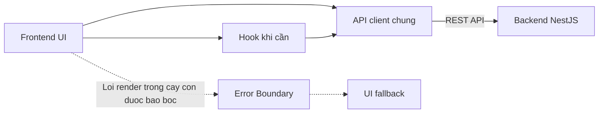

# Frontend Layers — React

Tra trách nhiệm và hướng gọi phía frontend React trước khi thêm component, hook hoặc giao tiếp API.

## 1. Hiện trạng

Áp dụng các quy tắc đã được Product Owner xác nhận khi bổ sung code frontend.

- `frontend/` có prototype React dùng dữ liệu giả lập; tài liệu quy định cách phân lớp mục tiêu và phần tích hợp API chưa triển khai.
- Tra công nghệ và phiên bản tại [Tech Stack](../tech-stack.md); không chọn thêm thư viện từ sơ đồ phân lớp.
- Trước khi viết hoặc sửa giao diện, đọc [UI Rules](../../rules/ui.md) về HeroUI, Tailwind CSS, token và theme.

## 2. Trách nhiệm

Tách hiển thị, logic dùng lại và giao tiếp HTTP.

| Thành phần | Trách nhiệm | Hướng gọi |
|---|---|---|
| UI | Hiển thị dữ liệu, nhận thao tác và quản lý trạng thái giao diện; hiển thị thông báo và điều hướng. | Gọi API client hoặc dùng hook khi cần. |
| Hook | Tách logic dùng lại; quản lý loading và lỗi khi logic này được đưa vào hook. | Gọi API client khi cần dữ liệu backend. |
| API client | Tập trung request HTTP tới backend; trả kết quả hoặc lỗi cho bên gọi. | Gọi REST API NestJS. |
| Error Boundary | Bắt lỗi render trong cây component con được bao bọc và hiển thị UI fallback. | Bao bọc toàn bộ `App` từ `main.tsx`. |

- Dùng một API client chung cho giao tiếp HTTP; chưa bắt buộc thêm lớp API riêng từng feature.
- Dùng Fetch API có sẵn của trình duyệt trong API client chung.
- Không rải request HTTP trong component UI; tập trung giao tiếp HTTP tại API client.
- Không bắt buộc mỗi màn hình có hook riêng; tách hook khi cần dùng lại logic.
- UI hoặc hook quản lý loading và lỗi; API client không tự hiển thị thông báo hoặc điều hướng.
- Frontend lấy dữ liệu qua backend; không truy cập PostgreSQL hoặc Repository của backend.
- Giữ render thuần; gọi API client từ event handler hoặc Effect phù hợp, không tạo request trong render.
- UI hoặc hook ngăn kết quả request cũ ghi đè dữ liệu của request hiện tại.
- Cleanup khi Effect không còn hiệu lực để kết quả request lỗi thời không cập nhật trạng thái giao diện.
- UI hoặc hook xử lý lỗi API; Error Boundary xử lý lỗi render trong cây con, không thay thế xử lý lỗi request hoặc event handler.
- Khi server từ chối lượt lưu dựa trên bản cũ, UI yêu cầu tải lại dữ liệu trước khi sửa tiếp; không tự gửi lại thay đổi trên bản cũ.

### Cấu hình Error Boundary

Áp dụng phạm vi và fallback đã được Product Owner xác nhận.

- Dùng một Error Boundary ngoài `App` tại `main.tsx`; chưa thêm boundary riêng từng feature.
- Dùng class component Error Boundary của React; không thêm dependency cho chức năng này.
- Hiển thị thông báo fallback: “Đã có lỗi hiển thị. Vui lòng tải lại trang.”
- Hiển thị nút “Tải lại trang”; thao tác tải lại toàn trang và có thể làm mất dữ liệu chưa lưu.
- Không hiển thị stack trace trên fallback.
- Tra vị trí `ErrorBoundary.tsx` tại [Folder Structure](../folder-structure.md).

## 3. Hướng gọi và ranh giới feature

Giữ giao tiếp HTTP tập trung và tránh phụ thuộc vào nội bộ feature khác.

- Cho phép `UI → API client → Backend`.
- Cho phép `UI → Hook → API client → Backend` khi cần tách logic dùng lại.
- Không import trực tiếp code nội bộ của feature khác.
- Đưa phần cần dùng chung giữa các feature sang code dùng chung theo vị trí đã xác nhận tại [Folder Structure](../folder-structure.md).
- Tra vị trí feature tại [Folder Structure](../folder-structure.md); không tự tạo cấu trúc thư mục chưa được xác nhận.

- Mũi tên liền biểu thị hướng gọi API; kết quả hoặc lỗi API trả ngược về bên gọi.
- Mũi tên nét đứt minh họa xử lý lỗi render khi có Error Boundary; không phải bước trong luồng request API.

## 4. Ví dụ luồng đọc dữ liệu

Minh họa trách nhiệm từng thành phần; không định nghĩa endpoint hoặc response schema.

1. Người dùng yêu cầu xem dữ liệu trên UI.
2. UI hoặc hook quản lý loading và gọi API client chung từ event handler hoặc Effect phù hợp, không gọi trong render.
3. API client gửi request tới REST API của NestJS.
4. API client trả kết quả hoặc lỗi về UI hoặc hook.
5. UI hoặc hook chỉ cập nhật trạng thái cho request còn hiệu lực; UI hiển thị dữ liệu hoặc lỗi phù hợp.

- Khi request được thay thế hoặc Effect được cleanup, không để kết quả lỗi thời ghi đè dữ liệu hiện tại.
- Nếu cây component con được bao bọc gặp lỗi render, Error Boundary hiển thị fallback theo cấu hình được xác nhận.

- Tra request, response và lỗi theo [REST API Rules](../../rules/rest-api.md); không tự đặt contract hoặc giá trị mặc định.
- Không coi việc ẩn nút hoặc kiểm tra phía frontend là thay thế cho kiểm tra quyền và nghiệp vụ trên backend.

## 5. Các mục cần xác nhận

Kiểm tra trạng thái xác nhận trước khi mở rộng quy tắc phân lớp frontend.

- Không còn mục phân lớp frontend chờ xác nhận trong phạm vi đã phỏng vấn.
- Khi cần thêm boundary hoặc thay đổi fallback đã chốt, xác nhận với Product Owner trước khi sửa.

## 6. Tài liệu liên quan

Tra các quyết định chung và phạm vi ngoài frontend.

- [Layers](../layers.md): Tra tài liệu phân lớp chung và giao tiếp giữa các app.
- [Overview](../overview.md): Tra các thành phần chính và kết nối hệ thống.
- [Tech Stack](../tech-stack.md): Tra công nghệ và lệnh phát triển.
- [Folder Structure](../folder-structure.md): Tra vị trí đặt code và test.
- [React Render Purity](https://react.dev/reference/rules/components-and-hooks-must-be-pure): Tra quy tắc side effect ngoài render.
- [React useEffect](https://react.dev/reference/react/useEffect#fetching-data-with-effects): Tra cleanup và tránh kết quả request lỗi thời.
- [React Error Boundary](https://react.dev/reference/react/Component#catching-rendering-errors-with-an-error-boundary): Tra phạm vi bắt lỗi render.
