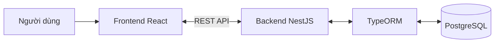

# Architecture Overview

Tra các thành phần chính, vai trò và cách kết nối của HRM trước khi đọc thiết kế chi tiết.

## 1. Hiện trạng

Phân biệt kiến trúc đã xác nhận với hệ thống đang chạy.

- Product Owner đã xác nhận các vai trò và kết nối trong tài liệu này.
- `frontend/` có prototype React dùng dữ liệu giả lập; `backend/` hiện rỗng. Sơ đồ mô tả kiến trúc mục tiêu, chưa phản ánh một hệ thống tích hợp.
- Tra phiên bản và trạng thái cấu hình tại [Tech Stack](tech-stack.md).
- Giữ overview ở mức thành phần hệ thống; không liệt kê module nghiệp vụ hoặc lớp kỹ thuật của backend.

## 2. Thành phần chính

Dùng bảng sau để xác định trách nhiệm của từng thành phần.

| Thành phần | Vai trò |
|---|---|
| Frontend React | Hiển thị giao diện, nhận thao tác người dùng và gọi backend qua REST API. |
| Backend NestJS | Cung cấp REST API, xử lý nghiệp vụ và kiểm soát truy cập dữ liệu. |
| TypeORM | Kết nối backend với PostgreSQL và thực hiện thao tác dữ liệu. |
| PostgreSQL | Lưu dữ liệu hệ thống; chỉ backend truy cập thông qua TypeORM. |
| Docker | Chạy frontend, backend và PostgreSQL trong container ở môi trường local. |

## 3. Kết nối và luồng dữ liệu

Theo dõi đường đi giữa người dùng, giao diện, backend và cơ sở dữ liệu.

1. Người dùng thao tác trên giao diện React.
2. React gửi request tới REST API của NestJS.
3. NestJS kiểm soát truy cập và xử lý nghiệp vụ; dùng TypeORM khi cần đọc hoặc ghi dữ liệu.
4. TypeORM thực hiện thao tác với PostgreSQL và trả kết quả về backend.
5. NestJS trả response qua API; React hiển thị kết quả cho người dùng.

- Frontend lấy dữ liệu qua API; không kết nối trực tiếp PostgreSQL.
- Sơ đồ mô tả kết nối logic; không xác định số service hoặc cách phân chia container.

## 4. Phạm vi Docker

Áp dụng phạm vi Docker đã được Product Owner xác nhận.

- Dùng Docker cho cả frontend, backend và PostgreSQL ở môi trường local.
- Repo chưa có Dockerfile hoặc cấu hình khởi động; tra các mục chưa xác nhận tại [Tech Stack](tech-stack.md).

## 5. Tích hợp bên ngoài

Theo [PRD](../PRD.md), hệ thống cần gửi email, lưu tệp riêng tư và nhập dữ liệu máy chấm công. Nhà cung cấp và giao thức tích hợp cụ thể chưa được xác nhận.

**Status:** TBD (To Be Determined)

- Chọn dịch vụ gửi email và cách cấu hình nào?
- Chọn dịch vụ lưu trữ tệp riêng tư và giao thức truy cập nào?
- Phase 1 nhập Excel/CSV theo `PD-013`; phương án đồng bộ tự động từ máy chấm công ở Phase 2 cần được xác nhận trước khi đặc tả.

## 6. Tài liệu liên quan

Đọc tài liệu chi tiết theo nhu cầu; không lặp lại đặc tả trong overview.

- [Tech Stack](tech-stack.md): Tra công nghệ, phiên bản, công cụ và lệnh phát triển.
- [Folder Structure](folder-structure.md): Tra cấu trúc thư mục và vị trí đặt file.
- [Layers](layers.md): Tra trách nhiệm và hướng gọi giữa các lớp.
- [Index Kiến trúc](index.md): Tra mục lục tài liệu kiến trúc hệ thống.
- [PRD](../PRD.md): Tra tổng quan sản phẩm; tra [đặc tả yêu cầu](../prd/index.md) cho quy tắc nghiệp vụ.
- [REST API Rules](../rules/rest-api.md): Tra quy tắc thiết kế và triển khai REST API.
