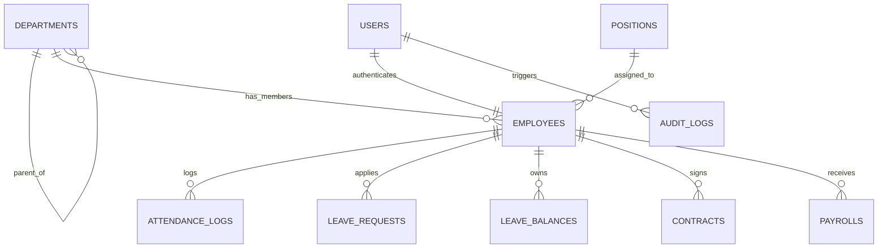

# 13. High-Level Data Model

[Quay lại PRD](../../PRD.md#13-high-level-data)

Tài liệu này đặc tả mô hình dữ liệu mức cao (High-Level Conceptual Data Model) và quan hệ giữa các thực thể cốt lõi trong hệ thống HRM.

- **Trạng thái:** Confirmed — Approved by Product Owner (PD-007, PD-009, PD-012, PD-038).

---

## 1. Danh mục Thực thể cốt lõi (Core Entities)

| Thực thể | Tên bảng DB | Khóa chính | Thuộc tính chính | Nguồn Master Data |
|---|---|---|---|---|
| **Nhân viên** | `employees` | UUID | `employee_code`, `first_name`, `last_name`, `email`, `phone`, `gender`, `dob`, `status`, `department_id`, `position_id` | Master Data hệ thống |
| **Phòng ban** | `departments` | UUID | `name`, `code`, `parent_id`, `manager_id`, `description` | Master Data hệ thống |
| **Vị trí / Chức vụ** | `positions` | UUID | `title`, `code`, `department_id`, `level` | Master Data hệ thống |
| **Tài khoản người dùng** | `users` | UUID | `email`, `password_hash`, `role`, `employee_id`, `is_active`, `must_change_password` | Xác thực & Quản trị |
| **Bản ghi chấm công** | `attendance_logs` | UUID | `employee_id`, `work_date`, `check_in_time`, `check_out_time`, `status`, `source`, `minutes_late`, `minutes_early` | ATT Module |
| **Đơn xin nghỉ phép** | `leave_requests` | UUID | `employee_id`, `leave_type`, `start_date`, `end_date`, `duration_days`, `status`, `approver_id`, `reason` | LEAVE Module |
| **Số dư phép năm** | `leave_balances` | UUID | `employee_id`, `year`, `entitled_days`, `transferred_days`, `used_days`, `held_days` | LEAVE Module |
| **Hợp đồng lao động** | `contracts` | UUID | `contract_number`, `employee_id`, `contract_type`, `start_date`, `end_date`, `base_salary`, `status` | CON Module (Phase 2) |
| **Kỳ lương & Bảng lương** | `payrolls` | UUID | `period_month`, `period_year`, `employee_id`, `actual_work_days`, `net_salary`, `status` | PAY Module (Phase 2) |
| **Nhật ký bảo mật** | `audit_logs` | UUID | `timestamp`, `actor_id`, `actor_role`, `action`, `resource`, `status`, `ip_address`, `details` | SYS Module |

---

## 2. Sơ đồ Quan hệ Thực thể mức cao (ERD)

---

## 3. Quy tắc Ràng buộc & Toàn vẹn Dữ liệu

1. **Khóa chính:** Mọi thực thể nghiệp vụ đều sử dụng UUID (v4 hoặc v7) làm định danh khóa chính duy nhất.
2. **Khóa ngoại:** Quan hệ bắt buộc dùng ràng buộc `ON DELETE RESTRICT` để chống xóa mất dữ liệu lịch sử liên đới.
3. **Phân loại dữ liệu nhạy cảm (Confidentiality):**
   - Dữ liệu định danh pháp lý (`id_card_number`), tài khoản ngân hàng (`bank_account_number`) và chi tiết bảng lương (`base_salary`, `net_salary`) thuộc cấp độ **Tuyệt mật (Confidential)**.
   - Bắt buộc kiểm soát quyền truy cập nghiêm ngặt theo RBAC và mã hóa đường truyền.
4. **Vòng đời dữ liệu (Data Lifecycle):**
   - Áp dụng Xóa mềm (Soft Delete) với trường `deleted_at TIMESTAMPTZ NULL` cho các thực thể Master Data (`employees`, `departments`, `positions`).
   - Nhật ký `audit_logs` là bảng chỉ ghi (Append-only), không có tính năng xóa hoặc cập nhật.
