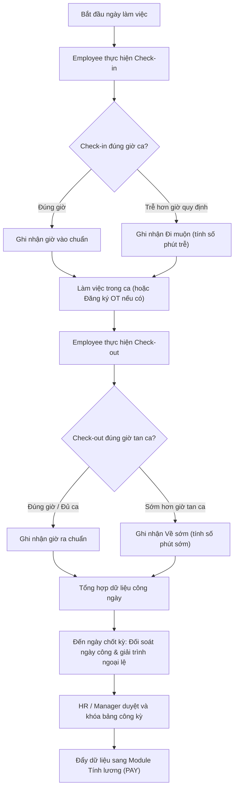

# 9.3. Attendance Workflow

[Quay lại Mục lục Workflows](index.md) | [Xem Use Cases Chấm công](../usecase/attendance-management.md)

Tài liệu này đặc tả quy trình quản lý thời gian làm việc hàng ngày và chốt bảng công kỳ.

- **Liên kết chức năng:** FR-ATT-001 đến FR-ATT-010, FR-LEAVE-001.
- **Trạng thái:** Confirmed bởi Product Owner (Ca chuẩn 08:00 - 17:30, ân hạn 15 phút, OT bắt buộc có đơn duyệt trước).

## 1. Sơ đồ quy trình (Workflow Diagram)

## 2. Các bước nghiệp vụ chi tiết

1. **Ghi nhận giờ vào:** Nhân viên chấm công đầu ca, hệ thống kiểm tra và tự động tính toán số phút đi muộn nếu có.
2. **Ghi nhận giờ ra:** Nhân viên chấm công cuối ca, hệ thống kiểm tra và tính toán về sớm.
3. **Đối soát ngoại lệ:** Nếu nhân viên quên chấm vào/ra hoặc xin nghỉ phép giữa giờ, nhân viên gửi giải trình hoặc đơn bổ sung công/phép.
4. **Tổng hợp kỳ công:** Đến ngày kết thúc kỳ công (ví dụ ngày 25 hàng tháng), hệ thống tự động tổng hợp tổng số ngày công chuẩn, số giờ làm thêm (OT), số giờ đi muộn/về sớm và số ngày nghỉ có phép/không phép.
5. **Khóa bảng công:** HR duyệt bảng công chính thức và bàn giao sang module Lương.
