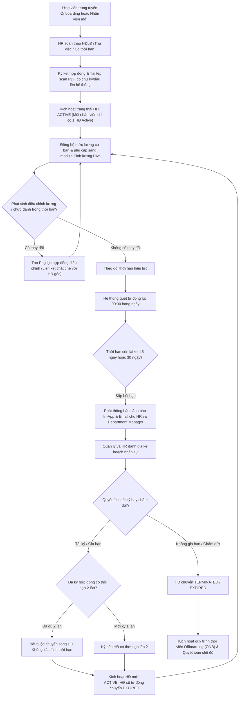

# 9.7. Contract Lifecycle Workflow

[Quay lại Mục lục Workflows](index.md) | [Xem Use Cases Hợp đồng](../usecase/contract-management.md)

Tài liệu này đặc tả quy trình quản lý toàn diện vòng đời hợp đồng lao động từ ký mới, điều chỉnh phụ lục, cảnh báo gia hạn đến thanh lý hợp đồng trong hệ thống HRM.

- **Liên kết chức năng:** FR-CON-001 đến FR-CON-009, FR-EMP-001, FR-PAY-001.
- **Trạng thái:** Confirmed — Approved by Product Owner (`PD-025`). Tuân thủ Bộ luật Lao động Việt Nam: Hợp đồng thử việc $\le$ 60 ngày, hợp đồng có thời hạn (12-36 tháng) tối đa 2 lần trước khi chuyển sang hợp đồng không xác định thời hạn.

---

## 1. Sơ đồ quy trình (Workflow Diagram)

---

## 2. Các giai đoạn nghiệp vụ chi tiết

### Giai đoạn 1: Ký mới & Kích hoạt hợp đồng
1. Sau khi ứng viên vượt qua tuyển dụng hoặc nhân viên mới tiếp nhận, HR Staff khởi tạo Hợp đồng lao động trên hệ thống với Số HĐ duy nhất.
2. Thiết lập loại hợp đồng (Thử việc tối đa 60 ngày; Có thời hạn từ 12-36 tháng; hoặc Không xác định thời hạn).
3. Sau khi hai bên ký kết trên văn bản giấy/ký số, HR Staff tải tệp PDF scan có chữ ký và con dấu lên hệ thống (dung lượng $\le$ 5MB).
4. HR Staff nhấn "Kích hoạt hợp đồng". Hệ thống kiểm tra: mỗi nhân viên chỉ có duy nhất 1 hợp đồng ở trạng thái `ACTIVE`.
5. Mức lương cơ bản và các khoản phụ cấp được tự động đồng bộ sang hồ sơ lương nhân sự trong module `PAY`.

### Giai đoạn 2: Điều chỉnh phụ lục hợp đồng
1. Khi có quyết định tăng lương, thăng chức hoặc thay đổi địa điểm làm việc, HR Staff tạo Phụ lục hợp đồng gắn với HĐLĐ đang hoạt động.
2. Phụ lục kế thừa các điều khoản không thay đổi từ hợp đồng gốc và có số phụ lục riêng.
3. Khi phụ lục có hiệu lực, mức lương mới được tự động cập nhật vào chu trình tính lương tiếp theo.

### Giai đoạn 3: Cảnh báo tự động & Gia hạn hợp đồng
1. Hệ thống tự động chạy Cron Job quét thời hạn hợp đồng hàng ngày lúc 00:00.
2. Khi hợp đồng còn 45 ngày, 30 ngày và 15 ngày, hệ thống phát thông báo cảnh báo tới HR Staff và Quản lý phòng ban.
3. HR Staff và Quản lý trao đổi, thống nhất:
   - **Trường hợp tái ký:** HR Staff khởi tạo hợp đồng mới tiếp nối (ngày bắt đầu của HĐ mới = ngày hết hạn HĐ cũ + 1 ngày). Nếu đã ký 2 lần có thời hạn, hệ thống bắt buộc chuyển sang loại Không xác định thời hạn. Hợp đồng cũ tự động chuyển sang `EXPIRED`, hợp đồng mới chuyển sang `ACTIVE`.
   - **Trường hợp không tái ký:** HR Staff chọn không gia hạn, hệ thống chuẩn bị kích hoạt quy trình thôi việc `ONB` và thanh lý hợp đồng.
