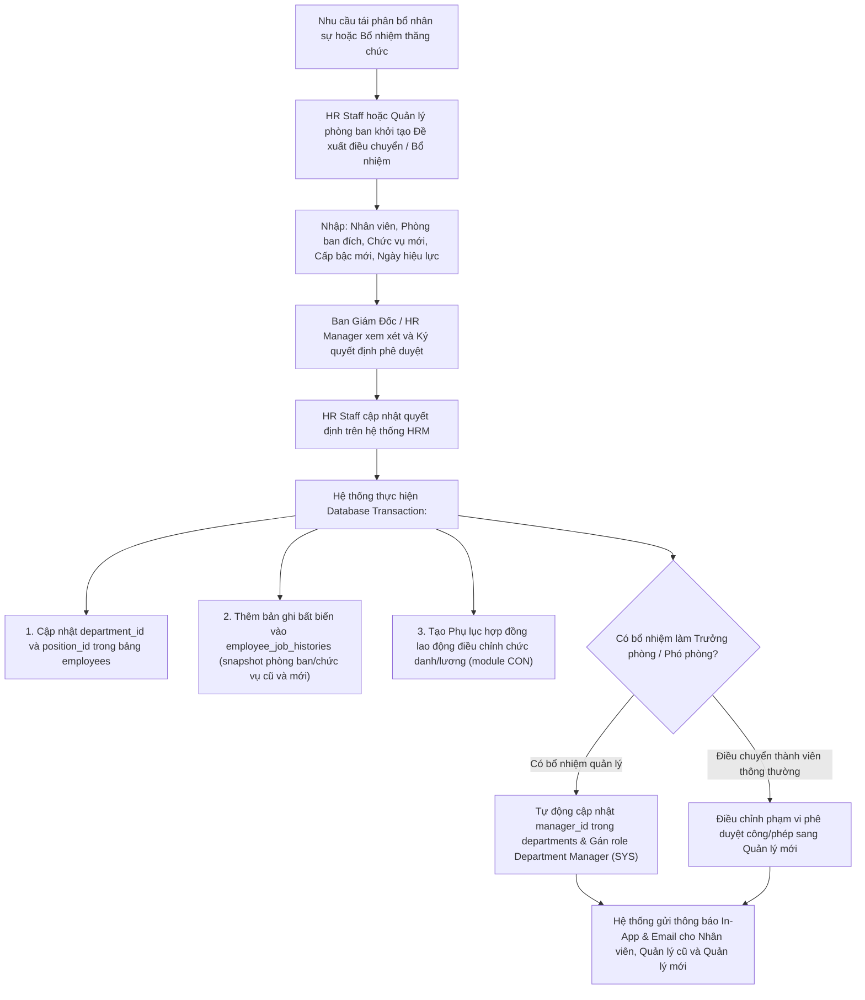

# 9.8. Employee Transfer & Promotion Workflow

[Quay lại Mục lục Workflows](index.md) | [Xem Use Cases Quản lý nhân viên](../usecase/employee-management.md)

Tài liệu này đặc tả quy trình điều chuyển phòng ban, thay đổi chức danh công tác và bổ nhiệm thăng chức cán bộ trong hệ thống HRM.

- **Liên kết chức năng:** FR-EMP-004, FR-EMP-007, FR-DEPT-004, FR-DEPT-005, FR-CON-004, FR-SYS-004.
- **Trạng thái:** Confirmed — Approved by Product Owner (`PD-008`, `PD-012`). Lưu vết lịch sử công tác bất biến; tự động đồng bộ phân quyền RBAC khi bổ nhiệm vai trò Trưởng phòng / Phó phòng.

---

## 1. Sơ đồ quy trình (Workflow Diagram)

---

## 2. Các giai đoạn nghiệp vụ chi tiết

### Giai đoạn 1: Đề xuất & Phê duyệt điều chuyển / Bổ nhiệm
1. Khi có nhu cầu điều chuyển nội bộ hoặc thăng chức cán bộ, HR Staff hoặc Quản lý phòng ban tạo Đơn đề xuất điều chuyển công tác trên hệ thống.
2. Thông tin bao gồm: Nhân viên điều chuyển, Phòng ban hiện tại, Chức vụ hiện tại $\rightarrow$ Phòng ban mới, Chức vụ mới, Mức lương mới (nếu có tăng lương), Ngày bắt đầu có hiệu lực và Số quyết định bổ nhiệm.
3. Ban Giám Đốc hoặc HR Manager xem xét và nhấn "Phê duyệt quyết định".

### Giai đoạn 2: Cập nhật dữ liệu & Lưu vết lịch sử công tác bất biến
1. Khi quyết định có hiệu lực, HR Staff mở hồ sơ nhân viên và bấm "Thực thi điều chuyển công tác".
2. Hệ thống thực hiện một transaction cơ sở dữ liệu an toàn:
   - Cập nhật trường `department_id` và `position_id` của nhân viên trong bảng `employees`.
   - Tạo một bản ghi mới trong bảng `employee_job_histories` lưu lại toàn bộ snapshot: Phòng ban cũ, Phòng ban mới, Chức vụ cũ, Chức vụ mới, Ngày hiệu lực, Người thực hiện và Ghi chú.
   - Bản ghi lịch sử này là bất biến (không thể sửa hoặc xóa), phục vụ tra cứu toàn bộ quá trình thăng tiến của nhân sự.

### Giai đoạn 3: Đồng bộ hợp đồng và phân quyền hệ thống (RBAC)
1. **Đồng bộ Hợp đồng lao động (`CON`):** Hệ thống tự động sinh Phụ lục hợp đồng lao động điều chỉnh chức vụ và mức lương mới, gửi thông báo cho HR và nhân viên ký kết.
2. **Đồng bộ phân quyền (`SYS`):**
   - Nếu nhân viên được bổ nhiệm làm **Trưởng phòng** (Head of Department): Hệ thống tự động cập nhật `manager_id` của phòng ban đó và nâng quyền tài khoản người dùng thành vai trò `Department Manager`. Nhân viên lập tức có quyền duyệt công, duyệt phép và đánh giá KPI cho toàn bộ nhân sự phòng ban mới.
   - Nếu nhân viên chuyển từ Trưởng phòng về nhân viên thông thường: Hệ thống tự động thu hồi vai trò Manager và chuyển về vai trò `Employee`.
3. Quản lý phòng ban cũ và Quản lý phòng ban mới đều nhận được thông báo để bàn giao nhân sự và tiếp nhận quản lý.
