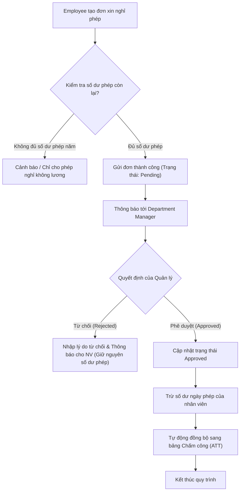

# 9.5. Leave Approval Workflow

[Quay lại Mục lục Workflows](index.md) | [Xem Use Cases Nghỉ phép](../usecase/leave-management.md)

Tài liệu này đặc tả quy trình từ khi tạo đơn xin nghỉ phép đến khi phê duyệt, trừ phép và đồng bộ bảng công.

- **Liên kết chức năng:** FR-LEAVE-001 đến FR-LEAVE-009, FR-ATT-001.
- **Trạng thái:** Confirmed bởi Product Owner (Phê duyệt 1 cấp trực tiếp bởi Department Manager, trừ số dư khả dụng và tự động đồng bộ bảng công ngay lập tức).

## 1. Sơ đồ quy trình (Workflow Diagram)

## 2. Các bước nghiệp vụ chi tiết

1. **Khởi tạo đơn:** Nhân viên chọn loại nghỉ, khoảng thời gian và lý do. Hệ thống kiểm tra số dư ngày phép khả dụng.
2. **Gửi đơn & Thông báo:** Đơn nghỉ chuyển trạng thái sang `Pending`, người quản lý trực tiếp nhận thông báo duyệt đơn.
3. **Phê duyệt hoặc Từ chối:**
   - Nếu từ chối: Quản lý bắt buộc nêu lý do, số ngày nghỉ giữ chỗ được hoàn lại cho nhân viên.
   - Nếu phê duyệt: Đơn chuyển sang `Approved`, số ngày phép chính thức bị trừ.
4. **Đồng bộ liên module:** Hệ thống tự động đánh dấu các ngày nghỉ hợp lệ vào bảng chấm công của nhân viên, giúp không bị tính là nghỉ không phép hoặc vắng mặt bất thường.
