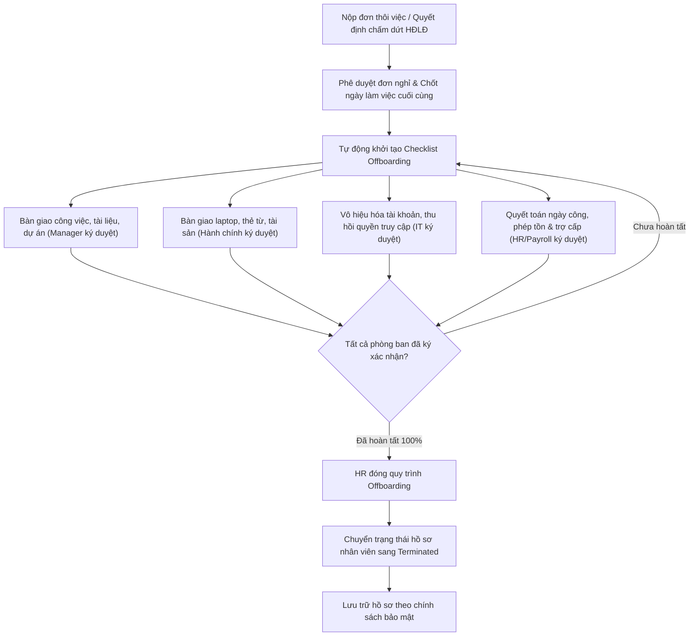

# 9.11. Employee Offboarding Workflow

[Quay lại Mục lục Workflows](index.md) | [Xem Use Cases Nghỉ việc](../usecase/onboarding-offboarding.md)

Tài liệu này đặc tả quy trình thôi việc, bàn giao công việc, thu hồi tài sản và vô hiệu hóa tài khoản nhân sự.

- **Liên kết chức năng:** FR-ONB-006 đến FR-ONB-009, FR-EMP-005, FR-SYS-001, FR-PAY-003.
- **Actors tham gia:** Employee, Department Manager, IT Admin, HR Staff.
- **Trạng thái:** Confirmed — Approved by Product Owner (2026-10-21) theo `PD-022`.

## 1. Sơ đồ quy trình (Workflow Diagram)

## 2. Các bước nghiệp vụ chi tiết

1. **Khởi tạo:** Nhân viên gửi đơn xin nghỉ việc hoặc công ty ra quyết định thôi việc. Ban Giám Đốc/Manager duyệt và chốt ngày làm việc cuối cùng.
2. **Kích hoạt checklist:** Hệ thống tạo danh sách kiểm tra thủ tục nghỉ việc phân bổ cho 4 nhóm: Quản lý trực tiếp, Hành chính tài sản, IT bảo mật và Kế toán lương.
3. **Bàn giao & Thu hồi:**
   - Hoàn tất bàn giao các dự án đang phụ trách.
   - Trả lại máy móc, chìa khóa, thẻ nhân viên.
   - IT khóa tài khoản đúng vào thời điểm ngày làm việc cuối cùng kết thúc.
   - Chốt quyết toán ngày phép còn tồn và lương tháng cuối.
4. **Kết thúc hồ sơ:** Sau khi đủ chữ ký điện tử xác nhận, trạng thái nhân viên chuyển thành `Terminated`. Dữ liệu được lưu trữ an toàn, không bị xóa vật lý để phục vụ kiểm toán (`PD-031, PD-038`).
