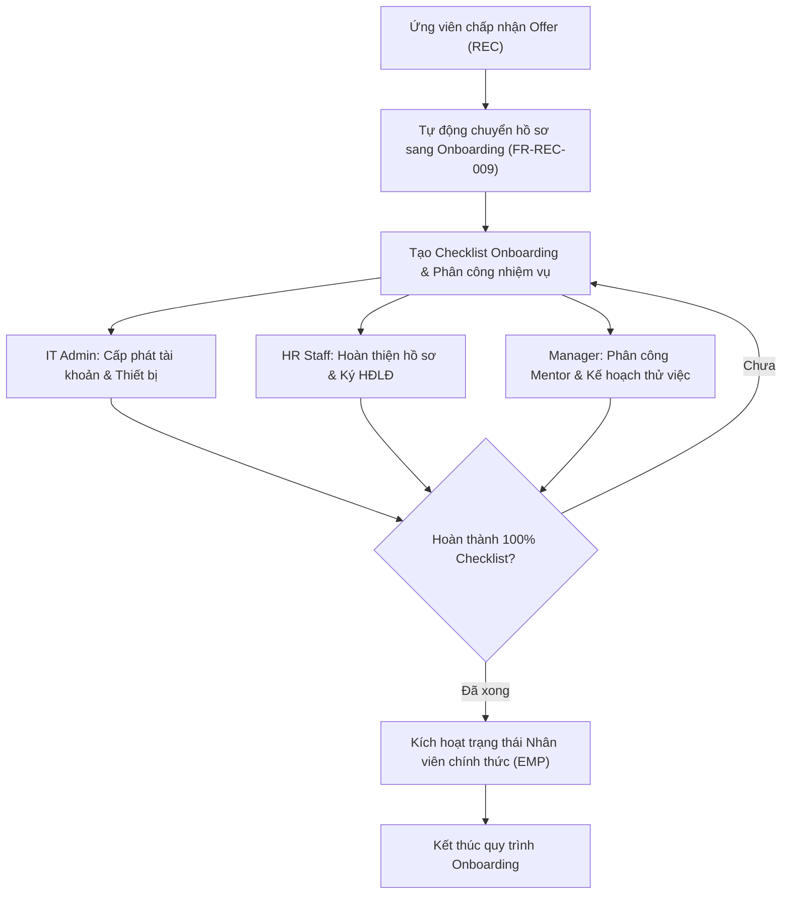

# 9.2. Employee Onboarding Workflow

[Quay lại Mục lục Workflows](index.md) | [Xem Use Cases Onboarding](../usecase/onboarding-offboarding.md)

Tài liệu này đặc tả quy trình tiếp nhận nhân viên mới từ lúc trúng tuyển cho đến khi hoàn thành hội nhập.

- **Liên kết chức năng:** FR-REC-009, FR-ONB-001 đến FR-ONB-005, FR-EMP-002, FR-SYS-001.
- **Actors tham gia:** HR Staff, IT Admin, Department Manager, Nhân viên mới.
- **Trạng thái:** Confirmed — Approved by Product Owner (2026-10-21) theo `PD-021`.

## 1. Sơ đồ quy trình (Workflow Diagram)

## 2. Các bước nghiệp vụ chi tiết

1. **Khởi tạo:** Sau khi ứng viên đồng ý nhận việc trong module Tuyển dụng (`REC`), hệ thống tự động đẩy dữ liệu sang module `ONB`.
2. **Giao việc:** Hệ thống sinh Checklist Onboarding mẫu và gửi thông báo công việc cho từng bên liên quan.
3. **Thực thi:**
   - IT cấp tài khoản hệ thống và bàn giao thiết bị làm việc.
   - HR thu thập hồ sơ nhân sự và ký kết hợp đồng lao động (`CON`).
   - Quản lý bộ phận hướng dẫn hội nhập và phân công công việc.
4. **Theo dõi:** Thanh tiến độ hiển thị % hoàn thành nhiệm vụ theo thời gian thực.
5. **Hoàn tất:** Khi tất cả các mục checklist được xác nhận, hồ sơ nhân viên chuyển từ trạng thái `Onboarding` sang `Active`.
