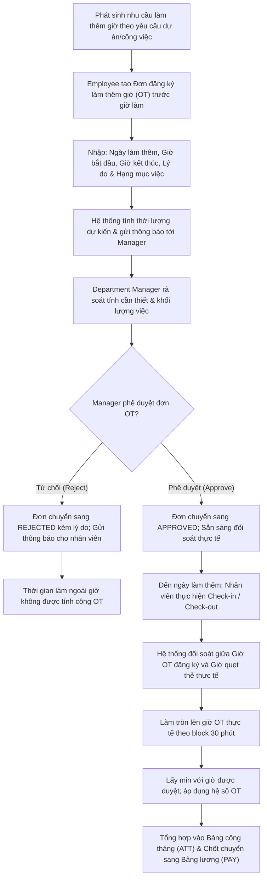

# 9.4. Overtime Approval Workflow

[Quay lại Mục lục Workflows](index.md) | [Xem Use Cases Chấm công](../usecase/attendance-management.md)

Tài liệu này đặc tả quy trình đăng ký, phê duyệt và đối soát giờ làm thêm (Overtime - OT) trong hệ thống HRM.

- **Liên kết chức năng:** FR-ATT-007, FR-ATT-010, FR-PAY-003.
- **Trạng thái:** Confirmed — Approved by Product Owner (`PD-014`). Làm tròn lên thời gian OT thực tế theo block 30 phút; đơn phải được Quản lý trực tiếp duyệt trước.

---

## 1. Sơ đồ quy trình (Workflow Diagram)

---

## 2. Các giai đoạn nghiệp vụ chi tiết

### Giai đoạn 1: Đăng ký đơn làm thêm giờ
1. Trước khi làm việc ngoài giờ quy định (sau 17:30 ngày làm việc hoặc vào các ngày Thứ Bảy, Chủ Nhật), Employee mở form "Đăng ký làm thêm giờ (OT)".
2. Employee chọn Ngày làm việc, nhập Giờ bắt đầu, Giờ kết thúc, Lý do làm thêm và Dự án/Hạng mục phụ trách.
3. Hệ thống tự động tính thời lượng dự kiến; thời gian OT thực tế được làm tròn lên theo block 30 phút khi đối soát.
4. Employee bấm "Gửi đơn phê duyệt". Đơn ở trạng thái `PENDING`.

### Giai đoạn 2: Quản lý phòng ban phê duyệt
1. Department Manager nhận được thông báo In-App và Email có đơn OT mới.
2. Manager xem xét khối lượng công việc, tính cấp bách và thời lượng làm thêm.
3. Manager đưa ra quyết định:
   - **Phê duyệt (`APPROVED`):** Đơn được chấp thuận, kích hoạt cơ chế theo dõi chấm công OT.
   - **Từ chối (`REJECTED`):** Bắt buộc nhập lý do từ chối. Nhân viên nhận thông báo và thời gian làm ngoài giờ sẽ không được tính tiền OT.

### Giai đoạn 3: Đối soát chấm công thực tế & Tổng hợp tính lương
1. Vào ngày làm thêm, kể cả ngày nghỉ/cuối tuần, nhân viên có đơn OT được duyệt có thể Check-in và Check-out trên Web; dữ liệu máy chấm công cũng được đối soát.
2. Hệ thống chạy thuật toán đối soát:
   - Số giờ OT ghi nhận = $\min(\text{Số giờ theo đơn được duyệt}, \text{Giờ OT thực tế làm tròn lên block 30 phút})$.
   - Nếu nhân viên về sớm hơn giờ đăng ký: Làm tròn lên thời gian thực tế theo block 30 phút, tối đa bằng giờ được duyệt.
   - Nếu nhân viên về muộn hơn giờ đăng ký: Chỉ tính tối đa bằng số giờ đã được Manager duyệt trước đó.
3. Cuối tháng, hệ thống tự động tổng hợp toàn bộ số giờ OT đã đối soát vào Bảng tổng hợp công tháng (`ATT`), phân loại theo hệ số lương:
   - Làm thêm ngày thường: Nhân hệ số 150% (x1.5).
   - Làm thêm ngày nghỉ cuối tuần (Thứ 7, CN): Nhân hệ số 200% (x2.0).
   - Làm thêm ngày lễ, tết: Nhân hệ số 300% (x3.0).
4. Số giờ OT này được khóa cùng bảng công và tự động đẩy sang module Tính lương (`PAY`) để chi trả trong kỳ lương.
