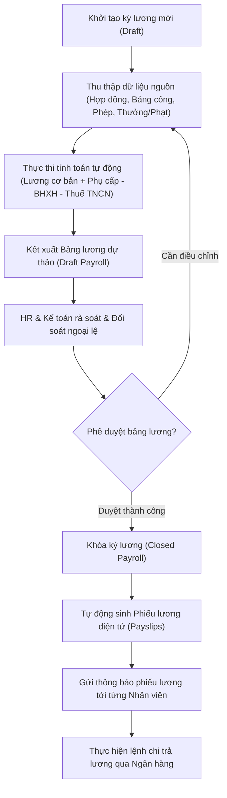

# 9.6. Payroll Processing Workflow

[Quay lại Mục lục Workflows](index.md) | [Xem Use Cases Lương](../usecase/payroll-management.md)

Tài liệu này đặc tả quy trình tính toán, phê duyệt, khóa kỳ và phát hành phiếu lương hàng tháng.

- **Liên kết chức năng:** FR-PAY-001 đến FR-PAY-011, FR-ATT-010, FR-LEAVE-001, FR-CON-001.
- **Actors tham gia:** Kế toán lương (Payroll Specialist), HR Manager, Ban Giám Đốc, Employee.
- **Trạng thái:** Confirmed — Approved by Product Owner (2026-10-21) theo `PD-017, PD-018, PD-019`.

## 1. Sơ đồ quy trình (Workflow Diagram)

## 2. Các bước nghiệp vụ chi tiết

1. **Khởi tạo:** Kế toán mở kỳ lương mới (ví dụ: Kỳ lương tháng 10/2026).
2. **Tổng hợp dữ liệu nguồn:** Hệ thống kéo dữ liệu từ Hợp đồng (Lương cứng, phụ cấp cố định), Chấm công (Số công thực tế, giờ OT), và Nghỉ phép (Nghỉ không lương).
3. **Tính toán:** Hệ thống tự động áp dụng công thức tính thu nhập chịu thuế, các khoản trích đóng bảo hiểm (BHXH, BHYT, BHTN) và thuế TNCN lũy tiến.
4. **Kiểm tra & Phê duyệt:** Cấp quản lý kiểm tra tổng quỹ lương, sau khi duyệt thì nhấn "Khóa kỳ lương" để ngăn chặn sửa đổi dữ liệu quá khứ.
5. **Công bố phiếu lương:** Mỗi nhân viên nhận được phiếu lương điện tử riêng biệt và an toàn trên cổng thông tin cá nhân.
