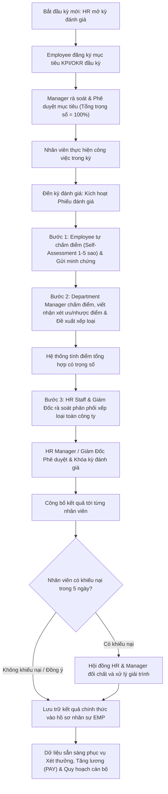

# 9.9. Performance Evaluation Workflow

[Quay lại Mục lục Workflows](index.md) | [Xem Use Cases Đánh giá hiệu suất](../usecase/performance-management.md)

Tài liệu này đặc tả quy trình đánh giá hiệu suất nhân sự định kỳ (6 tháng / 1 năm) trong hệ thống HRM.

- **Liên kết chức năng:** FR-PERF-001 đến FR-PERF-008.
- **Trạng thái:** Confirmed — Approved by Product Owner (`PD-023`, `PD-024`). Quy trình 3 bước chuẩn hóa: Tự đánh giá $\rightarrow$ Quản lý chấm điểm & phản hồi $\rightarrow$ HR khóa kết quả & xếp loại.

---

## 1. Sơ đồ quy trình (Workflow Diagram)

---

## 2. Các giai đoạn nghiệp vụ chi tiết

### Giai đoạn 1: Thiết lập & Phê duyệt mục tiêu đầu kỳ
1. Vào đầu kỳ đánh giá (Tháng 1 hoặc Tháng 7), HR Staff tạo kỳ đánh giá mới trên hệ thống.
2. Employee đăng ký từ 3 đến 5 mục tiêu trọng tâm trong kỳ (KPI định lượng hoặc OKR định tính), gán trọng số phần trăm cho từng mục.
3. Hệ thống kiểm tra ràng buộc bắt buộc: Tổng trọng số các mục tiêu phải bằng chính xác 100%.
4. Department Manager mở xem, trao đổi và bấm "Phê duyệt mục tiêu". Mục tiêu được khóa cứng (`Confirmed`) làm thước đo cuối kỳ.

### Giai đoạn 2: Tự đánh giá và Quản lý chấm điểm (Cuối kỳ)
1. **Bước 1 - Nhân viên tự đánh giá:** Khi kỳ đánh giá mở, Employee mở phiếu tự đánh giá, chấm điểm cho từng mục tiêu theo thang điểm từ 1.0 đến 5.0, đính kèm số liệu minh chứng và nhận xét cá nhân.
2. **Bước 2 - Quản lý trực tiếp chấm điểm:** Manager mở phiếu của nhân viên, đối chiếu kết quả tự chấm, điền điểm số của quản lý và bắt buộc viết nhận xét định tính (Ưu điểm nổi bật, Hạn chế cần khắc phục, Định hướng phát triển).
3. Hệ thống tính toán điểm tổng kết theo công thức trọng số chuẩn:
   $$\text{Final Score} = \sum (\text{Điểm tiêu chí} \times \text{Trọng số})$$

### Giai đoạn 3: Rà soát xếp loại, Khóa kết quả & Khiếu nại
1. **Bước 3 - Rà soát toàn công ty:** HR Staff và Ban Giám Đốc rà soát tỷ lệ phân bổ xếp loại của các phòng ban theo 5 mức:
   - Hạng A (Xuất sắc): Điểm $\ge 4.5$ (khoảng 10-15%).
   - Hạng B (Tốt): Điểm từ 3.8 đến 4.4 (khoảng 40-50%).
   - Hạng C (Đạt): Điểm từ 3.0 đến 3.7 (khoảng 30-40%).
   - Hạng D (Cần cải thiện): Điểm từ 2.0 đến 2.9 (dưới 5%).
   - Hạng E (Không đạt): Điểm $< 2.0$ (dưới 5%).
2. Giám Đốc bấm "Khóa kỳ đánh giá & Công bố kết quả". Kết quả hiển thị riêng tư cho từng nhân viên.
3. Nhân viên có quyền gửi khiếu nại trong vòng 5 ngày làm việc nếu thấy kết quả chưa thỏa đáng.
4. Sau thời hạn khiếu nại, kết quả trở thành bất biến, được đồng bộ vĩnh viễn vào tab "Hiệu suất" trong hồ sơ nhân viên (`EMP`) và làm căn cứ xét thưởng trong module `PAY`.
