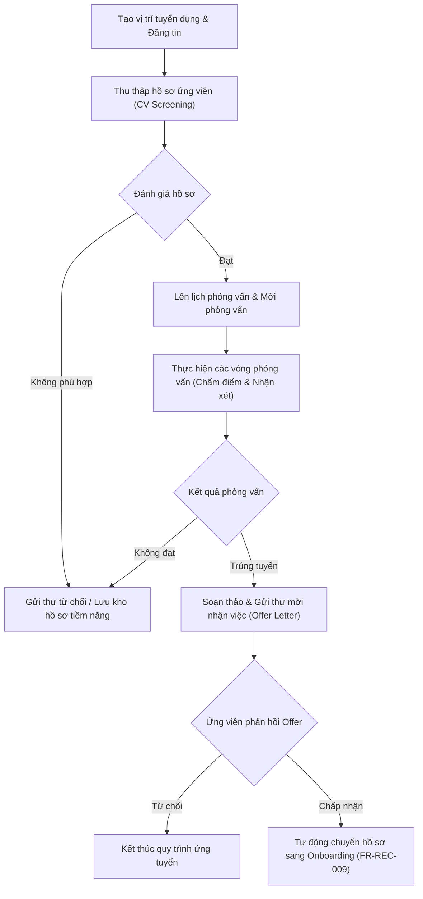

# 9.1. Recruitment Workflow

[Quay lại Mục lục Workflows](index.md) | [Xem Use Cases Tuyển dụng](../usecase/recruitment-management.md)

Tài liệu này đặc tả quy trình tuyển dụng nhân sự từ khi tạo yêu cầu tuyển dụng đến lúc gửi thư mời nhận việc.

- **Liên kết chức năng:** FR-REC-001 đến FR-REC-009, FR-ONB-001.
- **Actors tham gia:** HR Staff, Interviewer, Department Manager, Ứng viên.
- **Trạng thái:** Confirmed — Approved by Product Owner (2026-10-21) theo `PD-020`.

## 1. Sơ đồ quy trình (Workflow Diagram)

## 2. Các bước nghiệp vụ chi tiết

1. **Yêu cầu & Đăng tuyển:** Phòng ban gửi nhu cầu nhân sự, HR tạo vị trí tuyển dụng và đăng thông tin.
2. **Sàng lọc hồ sơ:** Tiếp nhận CV, lọc các ứng viên đáp ứng tiêu chí cơ bản vào danh sách phỏng vấn.
3. **Phỏng vấn:** Điều phối lịch phỏng vấn, người phỏng vấn nhập điểm đánh giá trực tiếp trên hệ thống sau buổi phỏng vấn.
4. **Đề xuất tuyển dụng (Offer):** Đối với ứng viên đạt yêu cầu, HR tạo thư mời làm việc với các điều kiện đãi ngộ.
5. **Chuyển tiếp (Đã xác nhận):** Khi ứng viên xác nhận đồng ý nhận việc, hệ thống tự động kích hoạt tiến trình chuyển giao sang quy trình Tiếp nhận nhân sự mới (`REC → ONB`).
