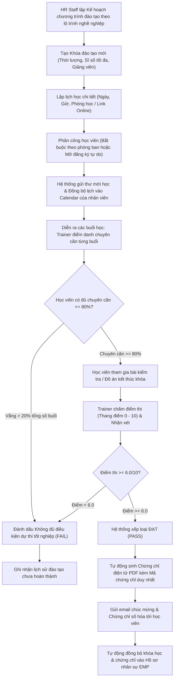

# 9.10. Training Management Workflow

[Quay lại Mục lục Workflows](index.md) | [Xem Use Cases Đào tạo](../usecase/training-management.md)

Tài liệu này đặc tả quy trình đào tạo nhân sự từ lập kế hoạch, tổ chức khóa học, điểm danh chuyên cần, kiểm tra kết thúc khóa đến cấp phát chứng chỉ số hóa trong hệ thống HRM.

- **Liên kết chức năng:** FR-TRAIN-001 đến FR-TRAIN-008, FR-EMP-001.
- **Trạng thái:** Confirmed — Approved by Product Owner (`PD-026`). Tiêu chí hoàn thành khóa học: Chuyên cần $\ge 80\%$ và Điểm kiểm tra $\ge 6.0/10$; cấp chứng chỉ điện tử có mã số duy nhất.

---

## 1. Sơ đồ quy trình (Workflow Diagram)

---

## 2. Các giai đoạn nghiệp vụ chi tiết

### Giai đoạn 1: Lập kế hoạch & Tổ chức khóa học
1. HR Staff tạo Chương trình đào tạo và thiết lập Khóa học trực thuộc (tên khóa, mục tiêu đào tạo, giảng viên nội bộ/đối tác, sĩ số tối đa).
2. HR Staff lập lịch học chi tiết các buổi trong tuần và gán phòng học hoặc link Google Meet.
3. Phân công học viên: HR chọn danh sách nhân sự bắt buộc hoặc mở cho nhân viên tự đăng ký. Hệ thống kiểm tra không vượt quá sĩ số lớp.
4. Hệ thống gửi thông báo và tự động thêm lịch học vào Calendar cá nhân của từng học viên.

### Giai đoạn 2: Giảng dạy & Theo dõi chuyên cần
1. Tại mỗi buổi học, Giảng viên (Trainer) hoặc HR phụ trách lớp thực hiện điểm danh học viên trên hệ thống (`Present`, `Absent`, `Late`).
2. Hệ thống tính lũy kế tỷ lệ chuyên cần. Nếu học viên vắng mặt quá 20% tổng thời lượng khóa học, hệ thống cảnh báo và tước quyền dự thi cuối khóa.

### Giai đoạn 3: Đánh giá & Cấp phát chứng chỉ
1. Kết thúc khóa, các học viên đủ điều kiện chuyên cần tham gia bài kiểm tra hoặc thuyết trình đồ án.
2. Giảng viên chấm điểm (thang điểm 10) và nhập nhận xét vào hệ thống.
3. Học viên đạt cả 2 tiêu chí (Chuyên cần $\ge 80\%$ và Điểm $\ge 6.0$) được xếp loại `PASS`.
4. Hệ thống tự động sinh Mã chứng chỉ duy nhất (`CERT-YYYY-NNNN`) và tạo tệp PDF Chứng chỉ số hóa có con dấu công ty.
5. Chứng chỉ được gửi qua email cho học viên và tự động đồng bộ vào tab "Đào tạo & Chứng chỉ" trong hồ sơ nhân viên (`EMP`) phục vụ xét duyệt thăng tiến.
